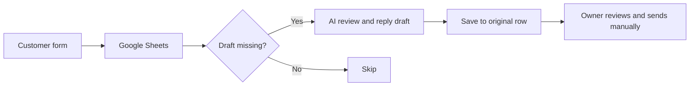

# EnquiryDesk

A no-code AI workflow that turns a business enquiry into a summary, clarification questions and a reply draft for human review. Built with Google Forms, Google Sheets and Make AI Agents.

## Workflow

The workflow uses a fictional photography business, BrightFrame Studio. It does not book services, promise availability, quote unapproved prices, or send customer messages automatically.

## Recreate without programming

1. Follow [SETUP.md](SETUP.md) to create your form and response sheet.
2. In a new Make scenario, select **More → Import blueprint** and upload `enquirydesk.blueprint.json`.
3. Select your own Google Sheets connection in both spreadsheet modules and your AI provider connection in the agent. Replace `YOUR_SPREADSHEET_ID` in both spreadsheet modules. Imported connections are intentionally unset.
4. Select a model available in your account. The tested live version uses Claude Haiku 4.5 through Make's built-in provider; account availability and credit costs vary.
5. Set the schedule and settings, test with fictional inputs, then activate. The sanitized blueprint was structurally checked but has not been imported into a separate account.

## Data layout

| Column | Meaning |
|---|---|
| A | Timestamp |
| B | Your enquiry |
| C | Your name (optional) |
| D | Contact email (optional) |
| E | Draft review |
| F | Status |

The trigger checks two new rows per run. A filter skips rows that already have a draft. The update step uses the trigger's row number, preserves A–D, saves the AI response to E and sets F to `Needs review`. Values are saved using **Raw**, so formula-like customer text is not evaluated during writeback.

## Review and testing

See [REVIEW.md](REVIEW.md) for two review passes, findings and verification limits. Six fictional behavioral examples are in `sample-results.json`. They are observed AI outputs, not guarantees of future accuracy. Exact headings and priority labels can vary; the output is stored as text rather than parsed into decisions.

Known limitations:
- The AI requires owner review; it can still produce unsupported statements.
- Distinct duplicate form submissions remain separate enquiries.
- A blank row can prevent Watch New Rows from seeing later rows.
- Two rows per run may cause a backlog.
- Make polling and AI generation consume credits.
- Incomplete execution storage is enabled, but fault recovery and high-volume behavior have not been tested under deliberate failures.
- Data is sent to Google, Make and the selected AI provider. Use synthetic data for demonstrations and agree an appropriate data-handling policy before real customer use.

## Repository contents

- `enquirydesk.blueprint.json`: sanitized importable workflow configuration.
- `ASSISTANT-INSTRUCTIONS.md`: the tested drafting rules.
- `SETUP.md`: account connections, form layout and operational settings.
- `TEST-CASES.md`: manual acceptance checklist.
- `sample-results.json`: fictional observed outputs.
- `REVIEW.md`: findings, checks and practical limits.

No private sheet links, connection identifiers, account screenshots, credentials or real customer submissions are included.
